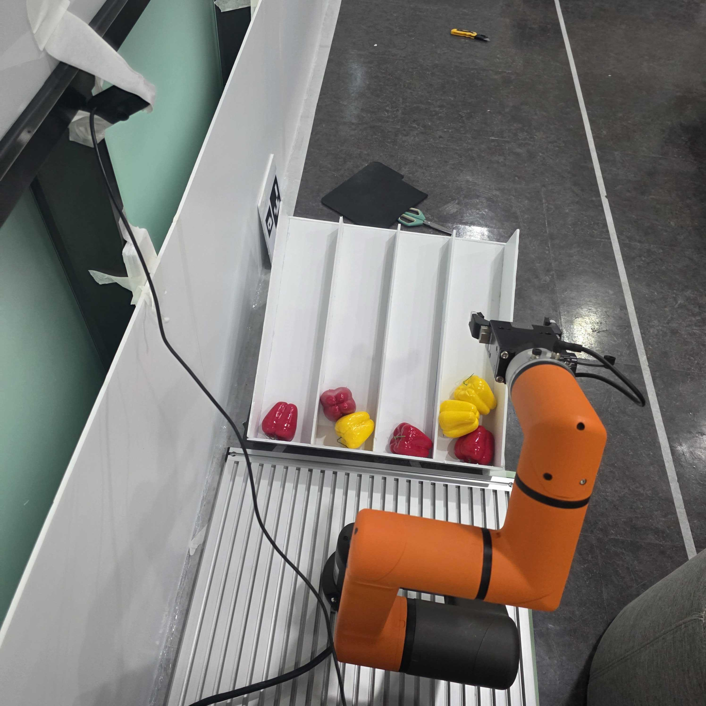
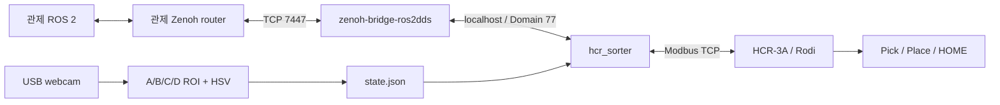

# HCR-3A Sorting Station

Hanwha HCR-3A와 USB 웹캠을 사용하는 파프리카 선별장 프로젝트입니다. A/B/C/D 고정 구역에서 빨강·노랑을 판정하고, ROS 2 배치 요청에 따라 Rodi가 티칭 경로로 집기·배출·HOME 복귀를 수행합니다.

이 저장소는 ManyFarm 팀 프로젝트의 선별장 자료를 개인 보관·재현용으로 정리한 스냅샷입니다. 출처와 정리 범위는 [NOTICE](NOTICE.md), 전체 자료 목차는 [문서 안내](docs/README.md)를 참고하세요. 정리일은 2026-11-05이며, 정리일이 새 현장 검증일을 뜻하지는 않습니다.



## 구성



PC 내부 ROS는 CycloneDDS를 사용하고, 외부 관제 연결은 Zenoh 브리지가 담당합니다. `rmw_zenoh_cpp`를 사용하는 구성과 구분하세요.

| 항목 | 현재 기준 |
|---|---|
| 실행 환경 | Ubuntu 24.04 / ROS 2 Jazzy / Python 3.12 |
| 로봇 | Hanwha HCR-3A / Rodi 티칭 프로그램 |
| 카메라 | OpenCV USB 웹캠, A/B/C/D 수동 ROI, HSV 빨강·노랑 |
| 관제 | `farm_interfaces` Action / Status, Zenoh TCP |
| PC 내부 ROS | `rmw_cyclonedds_cpp`, localhost, Domain 77 |
| 기본 관제 주소 | `tcp/192.168.0.20:7447` |
| HCR 연결 | PC `192.168.3.2:502` 서버 ↔ HCR `192.168.3.100` 클라이언트 |

주소와 장치 이름은 현장 값입니다. 다른 환경에서는 [설정 파일](config/sorting_station.json)을 맞춰야 합니다.

## 설치와 실행

ROS Jazzy가 설치된 PC에서 HCR용 의존성을 설치하고 빌드합니다. Zenoh 브리지 설치는 [현재 실행 안내](docs/hcr3a/09_ZENOH_START.md)의 연결 문서와 설치 항목을 참고하세요.

```bash
git clone https://github.com/HONEYDEV0310/hcr3a-sorting-station.git ~/manyfarm_ws/hcr3a-sorting-station
cd ~/manyfarm_ws/hcr3a-sorting-station
sudo apt update
sudo apt install -y python3-colcon-common-extensions python3-opencv python3-numpy \
  ros-jazzy-rclpy ros-jazzy-rosidl-default-generators ros-jazzy-std-srvs \
  ros-jazzy-rmw-cyclonedds-cpp
source /opt/ros/jazzy/setup.bash
bash src/sorting_station/hcr/build_sorter.sh
```

저장소 루트에서 일반 사용자로 실행합니다.

```bash
bash start_sorting.sh
```

웹캠·ROS 서버·Zenoh 브리지를 함께 시작합니다. Modbus 서버 권한과 loopback multicast 설정을 위해 sudo 비밀번호를 요청할 수 있습니다. 실행만으로 선별 Goal을 보내지는 않습니다.

카메라 창에서 a/b/c/d → 각 구역 드래그 → s로 저장합니다. 저장된 카메라/해상도가 다르면 기존 ROI를 백업하고 재설정합니다. 네 구역 설정 전에는 카메라 준비 상태가 되지 않습니다.

별도 터미널에서 같은 설정의 더미 관제를 엽니다.

```bash
bash start_sorting.sh --dummy
```

| 키 + Enter | 동작 |
|---|---|
| p | 상태 확인 |
| s | 실제 선별 작업 요청 |
| c | 진행 중 한 회 운반·복귀 후 취소 |
| r | 원인 해결 후 PC 오류 초기화 요청 |
| q | 더미 관제 종료 |

펜던트 메인·STATE_TX 실행과 실물 상태를 확인한 뒤 `ready=True`, `error=NONE`에서 시험합니다. 종료는 최종 Result와 HOME 복귀를 확인한 뒤 Ctrl+C로 합니다. 취소와 프로세스 종료는 물리 비상정지 명령이 아닙니다.

## 관제 연결

manyfarm5G 연결 후 관제 TCP 접속부터 확인합니다. 인터넷 연결과 내부망 통신은 별개입니다.

```bash
nc -vz -w 3 192.168.0.20 7447
```

| 인터페이스 | 이름 | 타입 |
|---|---|---|
| Action | `/sorter_01/sort_batch` | `farm_interfaces/action/SortBatch` |
| Status | `/sorter_01/status` | `farm_interfaces/msg/SorterStatus` |
| 복구 Service | `/sorter_01/reset_fault` | `std_srvs/srv/Trigger` |

`robot_id=sorter_01`이며 매 요청에 새 `task_id`를 사용합니다. Feedback 개수는 누적값이고, 최종 Result로 확정합니다. 반입 허용은 기본 false이며 실제 반입 가능을 확인한 경우 `--allow-receive`로 실행합니다.

관제 연결 시험은 [팀 통신 테스트 체크리스트](docs/hcr3a/10_ZENOH_TEAM_TEST.md), 필드·레지스터 계약은 [프로토콜 원본](docs/hcr3a/07_PROTOCOL_REFERENCE.md)을 따릅니다. `farm_interfaces` 정의는 양쪽이 같아야 합니다.

## 코드와 자료

```text
config/                           현장 설정과 DDS XML
scripts/start_sorting_station.py  통합 실행·프로세스 관리
scripts/check_sorting.sh          하드웨어 없는 회귀 시험
src/farm_interfaces/              Action·Status ROS 인터페이스
src/sorting_station/hcr/          카메라·ROI·진단·실행 스크립트
src/sorting_station/hcr_sorting/  배치 상태기계·Modbus·저널·더미 관제
docs/hcr3a/                       설치·비전·Rodi·운영·복구·검증
docs/*.pdf                       과거 펜던트 작성 참고자료
```

[현재 Zenoh 실행 안내](docs/hcr3a/09_ZENOH_START.md)를 우선하고, 이전 Domain 24·직접 LAN DDS·D435 중심 문서는 작성 당시 기록으로 읽으세요. 과거 안내에 있는 절대 경로는 자신의 checkout 경로로 바꿉니다.

## 검증과 복원 범위

```bash
bash scripts/check_sorting.sh
```

합성 영상·localhost TCP·배치 상태기계·실행기 수명주기를 시험하며 실물 로봇에 접속하지 않습니다. ROS 통합 시험과 현장 검증은 [검증 기록](docs/hcr3a/06_VALIDATION_HISTORY.md), 개인 스냅샷 검사는 [스냅샷 검증](docs/SNAPSHOT_VALIDATION.md)을 참고하세요.

운영 로그·SQLite 저널·빌드·venv·실제 ROI는 포함하지 않습니다. Rodi 네이티브 프로그램·티칭 좌표·TCP/Joint 설정은 펜던트에서 별도 백업해야 합니다. 안내 PDF만으로 실물 설정이 복원되지는 않습니다. 실제 파지 성공률, 최종 그리퍼 설정, 관제 두 PC의 종합 성공 기록은 자료에 남은 범위까지만 기재합니다.
